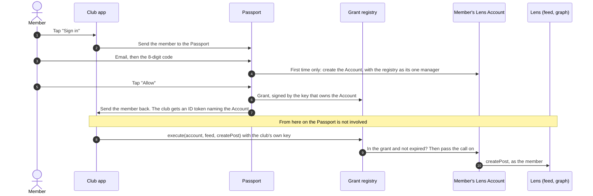

# Community Passport

One sign-in and one Lens Account across every community app on Monad.

This is a v1 reference implementation, written for review. It runs end to end on a local Monad chain against the real Lens contracts.

## The idea

- A member signs in on the Passport's own page with an emailed code. No wallet, nothing to install.
- The first time, the Passport creates a Lens Account for them. That Account is who they are in every club's app.
- When a member connects a club's app, they approve a **grant**: "this app may call these Lens functions as me, for 90 days". The grant is recorded in a small contract, the **grant registry**.
- The club's server then posts, follows and so on with its own key. The Passport is not in that path.
- A member can disconnect any app, and can move their Account to a passkey only they hold.

## How it works



Steps 1 to 7 are a standard web sign-in (OpenID Connect, the protocol behind "Sign in with Google"). Steps 8 to 10 are one transaction.

## Who can do what

| Who | Can | Cannot |
| --- | --- | --- |
| A club's app | Call the Lens functions in its grant, as the member, until the grant expires or is revoked | Call anything else. Move the member's MON. Change the Account's owner or managers. Reach a token: grants only name Lens contracts |
| The Passport, while it holds a member's key | Sign grants and revocations for that member, for functions on the listed Lens contracts. Hand the Account to the member's own key | Sign anything else: the key store refuses it ([the rule](apps/passport/src/policy.ts)) |
| The Passport, after a member takes their key | Show pages and relay what the member signs | Sign anything for that member. Sign them in from an email code |
| A member | Disconnect any app. Take their key over. Remove the registry from their Account, which ends every grant at once | |
| Whoever runs the registry (MF) | Pause it. Upgrade it, after a public delay (7 days by default) | Upgrade it without the delay. Touch an Account that never added the registry |

## What is in here

| Path | What it is |
| --- | --- |
| [`contracts/`](contracts) | The grant registry (about 250 lines of Solidity), its deploy script and its tests. 51 tests, 7 of them against the real Lens `Account` |
| [`packages/grants/`](packages/grants) | TypeScript helpers to build and sign grants. A club or a wallet can use them without the Passport |
| [`apps/passport/`](apps/passport) | The Passport server: email-code sign-in, the consent screen, the page where a member sees and disconnects apps, the passkey handover |
| [`e2e/`](e2e) | One test that plays the whole story on a local chain: sign in, post through the registry, disconnect, hand over (including a handover cut short half-way), sign in with the member's own key |
| [`docs/`](docs) | The design and the open decisions |

## What is real and what is a stand-in

| Piece | In this version |
| --- | --- |
| Grant registry | Complete. Not audited |
| Sign-in for apps | Complete, on a certified OpenID Connect library (`oidc-provider`) |
| Key store | **Stand-in.** Keys sit encrypted in the server's database. In production a key vendor holds them and enforces the same signing rule itself |
| Email | **Stand-in.** Codes are printed to the server's log |
| Passkey handover | Server side complete and tested. The browser side (about 120 lines, using Category Labs' Mera library) has not been tried on a real device yet |
| Club registration | A file the operator edits |

## Run it

Needs [Foundry](https://getfoundry.sh) 1.8.0 or later, [pnpm](https://pnpm.io) 12, yarn and jq. pnpm fetches the right Node version by itself. You need read access to the Lens contracts repository, which is a submodule.

```bash
git clone --recurse-submodules https://github.com/bensprks/community-passport && cd community-passport
```

```bash
pnpm install
```

Contract tests:

```bash
pnpm test:contracts
```

A local Monad chain with Lens and the registry deployed (leave it running):

```bash
pnpm chain
```

In a second terminal, the whole flow, end to end:

```bash
pnpm e2e
```

To click through the pages yourself: `pnpm dev:setup`, then `pnpm passport`, then open `http://localhost:4000`. Sign-in codes appear in the server's log.

## Docs

1. [Design](docs/design.md): the requirements as we understood them, the design, the flows, the costs and the limits.
2. [Grant registry](docs/registry.md): what the contract stores and checks, who controls it, and what can go wrong.
3. [Passport](docs/passport.md): what a club builds, how keys are held, and what production still needs.
4. [Changes to Lens](docs/lens-changes.md): none are needed for new accounts. One small one helps existing accounts.
5. [Decisions](docs/decisions.md): the alternatives we set aside and why, and the questions that are MF's to answer.
