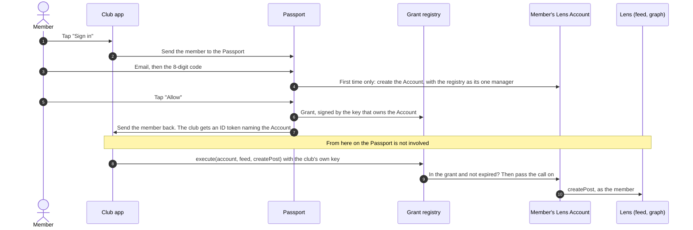

# Community Passport

One sign-in and one Lens Account across every community app on Monad.

Unaudited reference implementation.

## The idea

- A member signs in on the Passport's own page with an emailed code. No wallet, nothing to install.
- The first time, the Passport creates a Lens Account for them. That Account is who they are in every club's app.
- When a member connects a club's app, they approve a **grant**: "this app may post in its feed as me, for 90 days". The grant is recorded in a small contract, the **grant registry**.
- The club's server then posts, follows and so on with its own key. The Passport is not in that path.
- A member can disconnect any app, and can move their Account to a passkey only they hold, using [Mera](https://github.com/category-labs/mera).

## How it works



Steps 1 to 7 are a standard web sign-in (OpenID Connect, the protocol behind "Sign in with Google"). Steps 8 to 10 are one transaction.

## Who can do what

| Who | Can | Cannot |
| --- | --- | --- |
| A club's app | Call the Lens functions in its grant, as the member, until the grant expires or is revoked | Call anything else. Send the member's MON. Change the Account's owner or managers. Reach a token: grants only name Lens contracts |
| The Passport, while it holds a member's key | Sign grants for that member, to a registered app's key, for the functions that app is registered for. End grants. Hand the Account to the member's own key | Sign anything else: the key store refuses it ([the rule](apps/passport/src/policy.ts)) |
| The Passport, after a member takes their key | Show pages and relay what the member signs | Sign anything for that member. Sign them in from an email code |
| A member | Leave out the optional things an app asks for. Disconnect any app, or turn app access off altogether, which ends every grant and takes the registry off their Account. Take their key over | |
| The registry's admin and guardian | Pause it. Upgrade it, after a public delay (7 days by default) | Upgrade it without the delay. Touch an Account that never added the registry |

## What is in here

| Path | What it is |
| --- | --- |
| [`contracts/`](contracts) | The grant registry (about 250 lines of Solidity), its deploy script and its tests, plus the owner contract for accounts rooted in an email. 83 tests |
| [`circuits/`](circuits) | The Noir circuit that proves a member sent an email, and a page that times the proof in a browser |
| [`packages/grants/`](packages/grants) | TypeScript helpers to build and sign grants. A club or a wallet can use them without the Passport |
| [`apps/passport/`](apps/passport) | The Passport server: email-code sign-in, the consent screen, the page where a member sees and disconnects apps, the handover to a Mera passkey |
| [`apps/demo-club/`](apps/demo-club) | A pretend club's app, for showing the flow in a browser: sign in through the Passport, then post in the club's own Lens feed as the member |
| [`e2e/`](e2e) | One test that plays the whole story on a local chain: sign in, post through the registry, disconnect, turn app access off and on, hand over (including a handover cut short half-way), sign in with the member's own key |
| [`docs/`](docs) | The design and the open decisions |

## Status

| Piece | State |
| --- | --- |
| Grant registry | Complete. Not audited |
| Sign-in for apps | Complete, on a certified OpenID Connect library (`oidc-provider`) |
| Key store | **Stand-in.** Keys sit encrypted in the server's database. In production a key vendor holds them and enforces the same signing rule itself |
| Email | **Stand-in.** Codes are printed to the server's log |
| Passkey handover | Server side complete and tested. The browser side, about 120 lines on [Mera](https://github.com/category-labs/mera), has not been tried on a real device |
| Accounts rooted in an email | Contracts complete, and tested with real email proofs made two ways (Noir and Circom). The Passport still runs on a **stand-in** for the proof: receiving mail and making proofs are not built. The passkey page has not been tried with a real passkey |
| Club registration | A file the operator edits |
| Demo club app | For demonstration only: sessions in memory, a test key |

## Run it

Needs Node 26, [pnpm](https://pnpm.io) 12, [Foundry](https://getfoundry.sh) 1.8.0 or later, yarn and jq. You need read access to the Lens contracts repository, which is a submodule.

```bash
git clone --recurse-submodules https://github.com/bensprks/community-passport && cd community-passport
```

```bash
pnpm install
```

Contract tests:

```bash
pnpm test:contracts
```

A local Monad chain with Lens and the registry deployed (leave it running):

```bash
pnpm chain
```

In a second terminal, once the first says the contracts are deployed (about a minute), the whole flow, end to end:

```bash
pnpm e2e
```

`pnpm e2e` is a scripted test: it prints results and opens no browser.

## See it in a browser

With the chain still running, in a second terminal:

```bash
pnpm demo
```

That starts the Passport (`http://localhost:4000`) and a pretend club's app, "Queens Book Club" (`http://localhost:5001`). Everything they do lands on the local chain for real. Open the club's app and:

1. **Sign in.** Tap "Sign in with Community Passport". You are sent to the Passport. Type any email address; the 8-digit code is printed in the terminal, on a line starting `[passport] [mail]`. This creates a Lens Account.
2. **Allow.** The Passport shows what the club is asking for: posting in its own feed, plus two optional things you can tick or leave. Tap Allow. You land back at the club, signed in, and the club shows the Lens Account the Passport told it about.
3. **Post.** Write a review and post it. No prompt appears: the club posts in its own feed with its own key, through the grant registry, and shows the post as read back from Lens.
4. **Overreach.** Tap "Try to take over my account". The club tries to make itself a manager of your Account, and the grant registry refuses.
5. **Disconnect.** Follow "Manage or disconnect it there" to the Passport and tap Remove. Back at the club, posting is now refused.
6. **Come back.** Tap "Connect again" and Allow. Then sign out of the club and sign in again: this time there is no screen at all, because you are still signed in to the Passport and the grant is live.
7. **Turn it all off.** On the Passport's account page, tap "Turn off app access". Every grant ends and the registry comes off your Account. Connecting an app turns it back on.

To run the demo with no key held for members, use `pnpm demo:email`. Adding a device there needs a browser with a passkey, and the link printed in the terminal stands in for the member's reply. See [Accounts rooted in an email](docs/email-accounts.md).

The club's side is about 100 lines for sign-in ([`signin.ts`](apps/demo-club/src/signin.ts)) and 100 for acting on Lens ([`lens.ts`](apps/demo-club/src/lens.ts)).

## Docs

1. [Design](docs/design.md): the requirements, the design, the flows, the costs and the limits.
2. [Grant registry](docs/registry.md): what the contract stores and checks, who controls it, and what can go wrong.
3. [Passport](docs/passport.md): what a club builds, how keys are held, and what production still needs.
4. [Changes to Lens](docs/lens-changes.md): none are needed for new accounts. One small one helps existing accounts.
5. [Decisions](docs/decisions.md): the alternatives considered, and the open questions.
6. [Accounts rooted in an email](docs/email-accounts.md): a second mode with no key vendor, where a member's mail provider vouches for them onchain.
