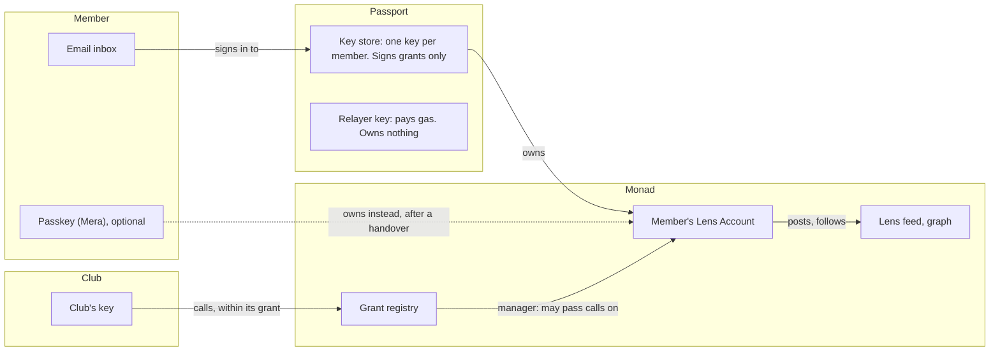

# Design

## What it has to do

1. **One identity everywhere.** A member has the same Lens Account in every club's app, so their posts, follows and reputation are in one place.
2. **Email first.** Signing up takes an email address and a code. No wallet, no seed phrase, no browser extension.
3. **Works in native apps and on any club's domain.** Clubs run their own sites and their own iOS and Android apps.
4. **No prompt per action.** Posting in a club's app must feel like posting in any app.
5. **Cheap per member.** No fee per monthly user to a vendor that grows with the network.
6. **A way out.** A member who wants to hold their own key can, without changing account.
7. **Small, auditable changes** to the Lens contracts, or none.

## The design in one paragraph

The Passport is one sign-in service for the whole network: it serves every app built on Lens on Monad. Every member has a Lens Account, owned by one key. To begin with the Passport holds that key for the member, in a key store that will sign only one kind of thing: a **grant**. A grant says which functions, on which contracts, one club's key may call as the member, and until when. Grants live in a contract, the **grant registry**, which each Account adds as a manager that can pass calls on and do nothing else. A club's server acts on Lens by calling the registry with its own key. The registry checks the grant and passes the call to the Account.

So the club never holds the member's key, the Passport is not needed for day-to-day actions, and what each app can do is written onchain where the member, the club and anyone else can read it.

## Who holds what

A **relayer** is a key that submits other people's signed messages and pays the gas. It has no authority of its own: the registry checks the member's signature, not who delivered it.

## The flows

**First sign-in.** The club sends the member's browser to the Passport. The member types their email, then the 8-digit code. The Passport makes a key in the key store and creates a Lens Account owned by that key, with the registry as its only manager. One transaction, paid by the relayer.

**Connecting an app.** The Passport shows the club's domain and what it is asking for, in plain words. The member taps Allow. The key store signs a grant, the relayer submits it, and the member is sent back to the club with a one-time code. The club's server swaps the code for an ID token, a signed statement from the Passport that says "this is Account 0x…". Nothing else is in it: not the email, not a name.

**Coming back.** If the member is still signed in to the Passport and the grant is live, the club gets its answer with no screen at all. A grant with less than half its time left is renewed: the member sees the consent screen again.

**Acting.** The club's server calls `registry.execute(account, target, data)` with its own key. No signature from the member, no call to the Passport.

**Disconnecting.** On the Passport's account page the member taps Disconnect. A signed revocation goes to the registry. The club's next call fails.

**Taking the key over.** The member makes a passkey on the Passport's page. [Mera](https://github.com/category-labs/mera), Category Labs' passkey account library, derives a key from it in the browser, with nothing to install, and the Account is transferred to that key. The Passport deletes its copy of the old key. From then on the member approves each new app with their fingerprint, the Passport can sign nothing for them, and an email code alone no longer signs them in.

## What each party is trusted with

| Party | Trusted with | If it is compromised |
| --- | --- | --- |
| A club | Its own key | The attacker can do what the club's grants allow (posting, following and so on), to the members who connected that club, until they are revoked or expire. Nothing else, and no other club's members |
| The Passport and its key store (members who have not taken their key) | Signing grants only when the member taps Allow. Handing an Account over only to its member | With the server alone: the attacker could grant themselves the ability to post and follow as those members. The key store refuses a grant that names anything but the listed Lens contracts, so tokens stay out of reach, and refuses a handover without a fresh sign-in. With the key store as well: everything those keys own. See "Limits" below |
| The Passport (members who hold their own key) | Showing the right thing on the consent screen | The attacker could show a misleading screen. The member's signature is still needed for every grant |
| The registry's admin | Upgrades, after the delay | A bad upgrade could misuse every Account that has the registry as a manager. The delay is the time to notice and remove it |
| The registry's guardian | Pausing | Apps stop working until it is resumed. Revoking still works while paused |
| A member's inbox (until they take their key) | Signing in | Whoever reads the inbox can sign in as the member |

## Costs

Measured on a local Monad chain with Monad's gas pricing. MON amounts assume 100 gwei per gas.

| Action | Gas | About | Who pays |
| --- | --- | --- | --- |
| Create a member's Account | 1.4M | 0.14 MON | Passport's relayer |
| Connect an app (one grant) | 0.23M | 0.023 MON | Passport's relayer |
| Disconnect an app | 0.18M | 0.018 MON | Passport's relayer |
| Hand an Account over | 0.18M over four transactions | 0.018 MON | Passport's relayer |
| A post through the registry | 0.57M, of which about 0.08M is the registry | 0.057 MON | The club |

A new member who connects one app costs about 0.16 MON. For 10,000 members that is about 1,600 MON, once.

Off chain, the running costs are a small server, a database, email (cents per thousand codes) and the key vendor (see [Decisions](decisions.md)).

## Limits

- **The Passport is a custodian until a member takes their key.** The signing rule narrows what it can do to grants and handovers, but within that the member is trusting the Passport's operator and the key vendor. The rule only protects members from a compromised Passport server if the key vendor enforces it and checks the member's sign-in itself.
- **Email is the root of trust** for members who have not taken their key. There is no second factor. A code is 8 digits and an address takes ten wrong guesses a day, which also means someone who knows a member's address can use up their guesses and keep them out for the day.
- **Grants stay with the Account.** They survive a handover, and they come back if a member removes the registry from their Account and later adds it again. That is deliberate (clubs keep working when a member takes their key), but there is no "disconnect everything" in one step. See [Decisions](decisions.md).
- **After a handover there is no recovery.** A member who loses their passkey, and has no synced copy, loses the Account.
- **Passkeys are tied to the Passport's domain for good.** If the domain changes, every passkey stops deriving its key. Choose the domain once.
- **A grant names functions, not arguments.** "May call `createPost` on the global feed" cannot be narrowed to "only in this club's group". Lens's own rules on feeds and groups still apply.
- **Grants do not limit how often** a club acts.
- **The club pays gas for its members' actions.** That is how Lens managers work on Monad today, with or without the registry.
- **Existing Lens Accounts** can use the registry, but their owner has to add it as a manager with a transaction from their own wallet. See [Changes to Lens](lens-changes.md).
- **Clubs are registered by the operator.** There is no self-service sign-up for clubs.
