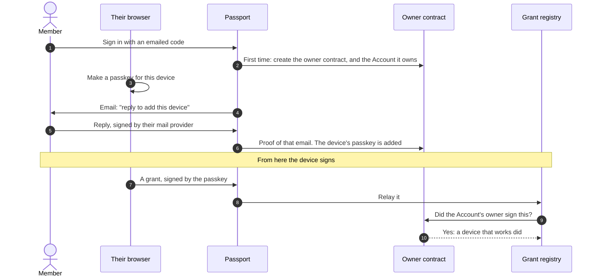

# Accounts rooted in an email

A second way to run the Passport, alongside the key vendor. Nobody holds a key for the member: not the Passport, not a vendor. Sign-up still takes only an email address.

Set `PASSPORT_CUSTODY=email` to use it. `pnpm demo:email` runs the demo this way.

## The idea

A typed code is checked by a server, so something trusted has to turn "they typed the code" into a signature. That something is a custodian. To do without one, the proof that a member controls their email has to be one a contract can check.

Such a proof exists. Mail providers sign every email they send. A proof of that signature on an email the member sent can be checked onchain, and nobody but the member's mail provider can produce it.

So:

- The Account's owner is a small contract, one per member: [`EmailOwner.sol`](../contracts/src/email/EmailOwner.sol).
- Each of the member's devices has an ordinary passkey. The owner contract accepts a passkey's signature as the owner's.
- The only way to add a device is a proof that the member sent an email approving it.

Signing in is unchanged, because a session moves nothing onchain. The reply is needed once per device.

## What the owner contract enforces

1. **Only the member's email adds a device.** The email approves one passkey, on one owner contract, on one chain. An email works once.
2. **The first device works at once.** A device added later by email waits out a delay (two days by default).
3. **A device that works can remove any other,** including one still waiting. So someone who gets into the inbox cannot take the Account over while the member still has a device.
4. **A device's passkey signs as the owner.** The grant registry and Lens need no change: they already accept a contract as owner.
5. **A device can have the owner contract make a call.** That is how a member moves their Account to a wallet of their own.

The Passport creates the contracts, relays and pays gas. It cannot add a device, because it cannot forge an email.

## The email proof

The proof sits behind one interface, [`IEmailProofVerifier`](../contracts/src/email/IEmailProofVerifier.sol). The member's reply carries one line, "signHash" and a number. The proof shows that their mail provider signed an email from them with that line, without revealing the email. The contract then checks that:

- the number is the command being approved;
- the sender is this member;
- the mail provider's key is on the onchain list of providers' keys;
- the email is less than a day old.

There are two real implementations and a stand-in.

| | [`NoirEmailVerifier`](../contracts/src/email/NoirEmailVerifier.sol) | [`ZKEmailVerifier`](../contracts/src/email/ZKEmailVerifier.sol) |
| --- | --- | --- |
| Circuit | [Noir](../circuits), in this repository, on ZK Email's Noir library | [ZK Email](https://github.com/zkemail/email-tx-builder)'s, in Circom |
| Proof system | UltraHonk. One public setup for every circuit, so the circuit can change | Groth16. A setup ceremony for each circuit |
| Making a proof | 1 second on a laptop. 2 to 10 seconds in a browser | A prover service on a large server |
| Add a device, gas on Monad | 6.0M (0.60 MON) | 2.7M (0.27 MON) |
| Proof size | 9,920 bytes | 256 bytes |
| Library | Pinned to changes not yet merged, which port it to Noir 1.0. Its audit covers an earlier version | Released |

Both are tested with a real proof of a real reply sent from Gmail, which ZK Email publish with their own tests. A real proof adds a device through the owner contract, and that device's passkey then signs. The published email approves a fixed number, and no passkey can be made to match it, so in that one test the owner contract is told that the number means "add this passkey". Nothing else is changed.

**The stand-in:** [`AttestedEmailVerifier`](../contracts/src/email/AttestedEmailVerifier.sol), which takes one key's word that it saw the email. The Passport and the demo still run on this one, and a link printed in the terminal stands in for the reply. With it, whoever holds that key can add a device to any member, so it is a custodian by another name.

What is left before the Passport can run on a real one:

- Receiving the member's reply.
- Making the proof from it. With Noir the Passport's own server can, in about a second. The Circom route needs a prover service.
- The list of mail providers' keys on Monad, and someone to keep it current. Providers change keys: the key that signed the test email was withdrawn in June 2026.

The passkey page has not been tried with a real passkey. The tests play the passkey with a key that signs exactly what a browser's passkey returns.

## Measured

With Monad's gas pricing. MON amounts assume 100 gwei per gas.

| Step | Gas | About |
| --- | --- | --- |
| Create the owner contract | 0.14M | 0.014 MON |
| Create the Account | 1.37M, as before | 0.14 MON |
| Add a device with a real email proof, Noir | 6.0M | 0.60 MON |
| Add a device with a real email proof, Circom | 2.7M | 0.27 MON |
| Connect an app, signed by a passkey | 0.27M (0.23M with a key) | 0.027 MON |
| Disconnect an app, signed by a passkey | 0.21M (0.16M with a key) | 0.021 MON |

A new member with one device and one app costs about 7.8M gas (0.78 MON) with Noir and 4.5M (0.45 MON) with Circom, against 0.16 MON with a key vendor.

Where the gas goes:

| | Noir | Circom |
| --- | --- | --- |
| Checking the proof | 5.82M | 1.95M |
| The same check with Ethereum's pricing | 2.64M | 0.44M |
| The rest of adding a device | 0.17M | 0.7M |
| Deploying the verifier, once | 4.1M | |

Monad prices the curve operations both checks use at five times Ethereum's.

### Making a Noir proof

One email from Gmail, on a 16-core Apple M3 Max laptop. The witness is the step before the proof, and runs on one thread.

| Where | Threads | Witness | Proof | Peak memory |
| --- | --- | --- | --- | --- |
| Native | 16 | 0.6 s | 1.1 s | 0.5 GB |
| WebAssembly in Node | 16 | 0.6 s | 1.8 s | 1.3 GB |
| WebAssembly in Node | 4 | 0.6 s | 3.2 s | 1.1 GB |
| WebAssembly in Node | 1 | 0.6 s | 9.4 s | 1.1 GB |
| Browser (Chromium) | 16 | 1.0 s | 1.8 s | |
| Browser | 8 | 1.0 s | 2.0 s | |
| Browser | 4 | 1.0 s | 3.1 s | |
| Browser | 2 | 1.0 s | 5.3 s | |
| Browser | 1 | 1.0 s | 9.3 s | |

What a browser downloads:

| | Size | Compressed | When |
| --- | --- | --- | --- |
| The prover | 11.3 MB | 8.2 MB | First visit |
| The circuit | 2.8 MB | 1.4 MB | First visit |
| The Noir runtime | 3.8 MB | 1.2 MB | First visit |
| The proof system's public setup, from its publisher | 22.9 MB | | First visit. 4.1 MB on later ones |

Not measured: a phone. The proof needs about 1.1 GB of memory in WebAssembly, which is near what a phone's browser allows a page. More than one thread needs the page served with two isolation headers.

To make the proof in the member's browser, the signed email has to reach the browser. A reply goes to the Passport's mailbox, so the Passport makes the proof. A browser proof fits an email the member already holds.

## What it costs

- **One reply per device,** on top of the typed code.
- **A list of mail providers' signing keys onchain,** which someone has to keep current.
- **A proof system and a circuit to trust,** in place of a vendor.
- **The inbox is still the root,** as in any email login. The delay, and a device's power to remove another, are what blunt a stolen inbox.
- **A device with a working passkey has full control of the Account.** A passkey is unlocked by the device's own check (a fingerprint, a PIN).
