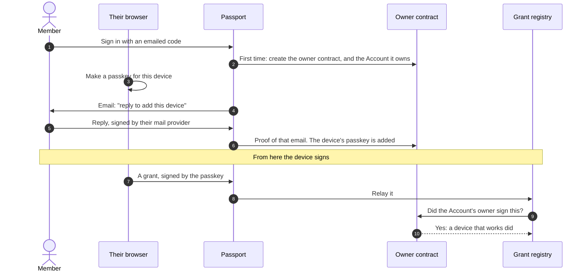

# Accounts rooted in an email

A second way to run the Passport, alongside the key vendor. Nobody holds a key for the member: not the Passport, not a vendor. Sign-up still takes only an email address.

Set `PASSPORT_CUSTODY=email` to use it. `pnpm demo:email` runs the demo this way.

## The idea

A typed code is checked by a server, so something trusted has to turn "they typed the code" into a signature. That something is a custodian. To do without one, the proof that a member controls their email has to be one a contract can check.

Such a proof exists. Mail providers sign every email they send. A proof of that signature on an email the member sent can be checked onchain, and nobody but the member's mail provider can produce it.

So:

- The Account's owner is a small contract, one per member: [`EmailOwner.sol`](../contracts/src/email/EmailOwner.sol).
- Each of the member's devices has an ordinary passkey. The owner contract accepts a passkey's signature as the owner's.
- The only way to add a device is a proof that the member sent an email approving it.

Signing in is unchanged, because a session moves nothing onchain. The reply is needed once per device.

## What the owner contract enforces

1. **Only the member's email adds a device.** The email approves one passkey, on one owner contract, on one chain. An email works once.
2. **The first device works at once.** A device added later by email waits out a delay (two days by default).
3. **A device that works can remove any other,** including one still waiting. So someone who gets into the inbox cannot take the Account over while the member still has a device.
4. **A device's passkey signs as the owner.** The grant registry and Lens need no change: they already accept a contract as owner.
5. **A device can have the owner contract make a call.** That is how a member moves their Account to a wallet of their own.

The Passport creates the contracts, relays and pays gas. It cannot add a device, because it cannot forge an email.

## What is a stand-in

The email proof sits behind one interface, [`IEmailProofVerifier`](../contracts/src/email/IEmailProofVerifier.sol). This version ships a development stand-in, [`AttestedEmailVerifier`](../contracts/src/email/AttestedEmailVerifier.sol), which takes one key's word that it saw the email. In the demo, opening a link printed in the terminal stands in for the reply.

With the stand-in, whoever holds that key can add a device to any member, so it is a custodian by another name. The design only delivers what it promises once the real proof is in its place. That is the next piece of work:

- [ZK Email](https://github.com/zkemail/email-tx-builder)'s verifier and its list of mail providers' signing keys, in place of the stand-in.
- Receiving the member's reply, and a prover that turns it into the proof.

The passkey page has not been tried with a real passkey. The tests play the passkey with a key that signs exactly what a browser's passkey returns.

## Measured

On a local chain with Monad's gas pricing. MON amounts assume 100 gwei per gas.

| Step | Gas | About |
| --- | --- | --- |
| Create the owner contract | 0.14M | 0.014 MON |
| Create the Account | 1.37M, as before | 0.14 MON |
| Add a device, with the stand-in | 0.18M | 0.018 MON |
| Check one ZK Email proof | 1.98M (0.44M with Ethereum's pricing) | 0.2 MON |
| Connect an app, signed by a passkey | 0.27M (0.23M with a key) | 0.027 MON |
| Disconnect an app, signed by a passkey | 0.21M (0.16M with a key) | 0.021 MON |

The proof check was measured by deploying ZK Email's verifier contract and calling it with a well-formed proof that does not verify. The cost does not depend on whether it verifies.

A new member with one device and one app would cost about 4M gas, 0.4 MON, against 0.16 MON with a key vendor. Half of that is the one proof.

Not measured: how long a proof takes to make.

## What it costs

- **One reply per device,** on top of the typed code.
- **A list of mail providers' signing keys onchain,** which someone has to keep current.
- **A proof system to trust,** in place of a vendor.
- **The inbox is still the root,** as in any email login. The delay, and a device's power to remove another, are what blunt a stolen inbox.
- **A device with a working passkey has full control of the Account.** A passkey is unlocked by the device's own check (a fingerprint, a PIN).
