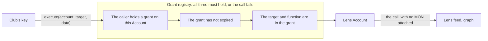
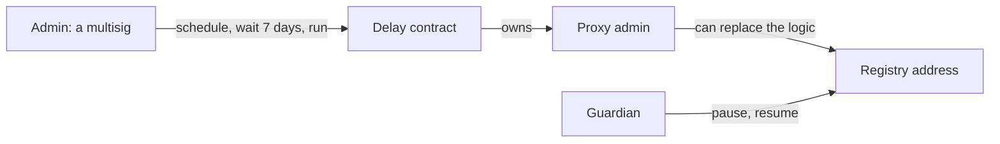

# Grant registry

The one contract in this design: [`GrantRegistry.sol`](../contracts/src/GrantRegistry.sol), 270 lines, with its interface in [`IGrantRegistry.sol`](../contracts/src/IGrantRegistry.sol).

## Why a contract at all

A Lens Account can name **managers**: other addresses allowed to have it make calls. A manager that may "execute transactions" can call any function on any contract as the Account, for ever. There is no way to say "only these functions" or "only until March".

Giving each club's key that power is the wrong shape: one leaked club key would be able to do anything, as every member of that club, with no end date.

The registry is the missing piece. An Account adds the registry as its manager, once. The registry then passes a call on only when the caller holds a grant for that Account that names the function being called and has not expired.



## What it stores

| Thing | Meaning |
| --- | --- |
| **Scope** | A list of up to 32 (contract, function) pairs. Stored once under the hash of the list, and never changed afterwards. Anyone can store one. Stored on its own it gives nobody anything |
| **Grant** | For one Account and one caller (the **grantee**, a club's key): which scope, and until when. One grant per Account and grantee. A new one replaces the old |
| **Used numbers** | Each signed message carries a number that works once per Account, so a signature cannot be submitted twice |
| **Guardian, paused** | Who can pause, and whether it is paused |

## What it does

| Function | Who can call it | What it does |
| --- | --- | --- |
| `defineScope(list)` | Anyone | Stores a list of functions under its hash |
| `grant(account, grantee, scope, expiry)` | The Account's owner | Records a grant |
| `grantWithSig(…, signature)` | Anyone, with the owner's signature | The same. This is what the Passport's relayer calls |
| `revoke(account, grantee)` | The Account's owner, or the grantee itself | Ends a grant. A club whose key leaked can end its own grants |
| `revokeWithSig(…, signature)` | Anyone, with the owner's signature | The same |
| `execute(account, target, data)` | A grantee | Checks the grant, then has the Account make the call |
| `setPaused`, `setGuardian` | The guardian | Pause and resume. Hand the role on |

## The rules it enforces

1. **Only the Account's current owner can grant.** The registry asks the Account who its owner is each time. If the Account changes owner, signatures from the old owner stop working.
2. **The owner signs the whole list of functions**, not a hash of it. A wallet shows each contract and function before the owner signs.
3. **A signature is good for one registry on one chain, once, for a short time.** It names the chain, the registry's address, the Account, a number that works once and a deadline.
4. **A grant lasts a year at most.** One that nobody renews ends by itself.
5. **`execute` never attaches MON to the call.**
6. **A call with no function name is never allowed.** That rules out plain transfers.
7. **Revoking always works**, including while paused.

## What a grantee can never do, whatever the grant says

These hold because of how the registry sits on the Account, and are tested against the real Lens `Account` in [`LensAccount.t.sol`](../contracts/test/LensAccount.t.sol):

- **Move the Account's MON.** `execute` sends none.
- **Change the Account's owner or managers.** Those functions answer only to the owner.
- **Reach an Account that has not added the registry.**

And if a member removes the registry from their Account, every grant on that Account stops working at once.

## Tokens

**A grant must never name a token contract**, or any contract that holds value for the Account. The registry does not judge what a grant lists: it enforces exactly what the owner signed. Keeping tokens out is the job of whoever asks for the signature:

- The Passport only registers clubs, and its key store only signs grants, whose functions are on a fixed list of Lens contracts (feeds, graphs and so on).
- A member who signs with their own wallet sees every contract and function in the message.

## Who controls it



- The registry sits behind a standard OpenZeppelin proxy, so the address that Accounts add as their manager stays the same when its logic is replaced.
- Replacing the logic goes through a delay contract (OpenZeppelin's `TimelockController`): the admin schedules the change in public, waits (7 days by default), then runs it. Nothing can skip the wait, and the delay itself can only be changed through the same wait.
- The guardian can pause and resume. It cannot upgrade, grant or act.
- The registry does not need any permission from the Lens contracts or from whoever controls them. It is a separate contract that Accounts opt into.

**Why upgradeable.** The contract is new and unaudited. If a flaw is found, the alternative to an upgrade is asking every member to remove one manager and add another. **What that costs.** Whoever holds the admin role could, after the delay, replace the logic with something that misuses every Account that has the registry as a manager. That is the main thing a member trusts the registry's admin with. The delay is there so that anyone watching can warn members to remove the registry first.

## What can go wrong

| Risk | What limits it |
| --- | --- |
| A club's key leaks | The attacker gets that club's grants only: the listed Lens functions, on the members who connected that club, until expiry. The club or each member can revoke |
| A relayer submits a signature late, or twice, or to another registry | Deadline, single-use number, chain and registry address are all signed |
| Someone watching the network submits a member's signed grant first | The outcome is the one the member signed, so nothing is gained. The relayer's own submission then fails and the member sees an error, but the grant is live and their next sign-in goes straight through |
| A member is tricked into signing a grant | The signed message lists every contract and function. Whatever it lists, it cannot change the Account's owner or managers or send its MON. See "Tokens" above for why the list matters |
| A scope lists a function on a token or some other contract | The registry does not judge scopes. The Passport does: it refuses to register or sign anything outside its list of Lens contracts |
| A flaw in the registry | The guardian pauses. Members can still revoke, or remove the registry from their Account. An upgrade follows after the delay |
| The admin key is stolen | The attacker must schedule in public and wait out the delay |
| A grant outlives a member's interest | Expiry, a year at most. 90 days by default in the Passport |
| An Account is sold or given away with grants on it | Grants stay with the Account, not the owner. The new owner should revoke them. They can see them from the registry's events |

## Tests

```bash
cd contracts && forge test
```

51 tests. 40 cover the registry on its own, including every rule above and two fuzz tests ("only ever calls a function in the grant", "expiry is always within a year"). 7 run against the real Lens `Account`. 4 cover the deploy script and the upgrade delay.

Not done: an audit, and a formal check of the storage layout across upgrades (the storage sits at a fixed, namespaced location, and one test checks that an upgrade keeps grants and signatures working).

## Deploying

[`Deploy.s.sol`](../contracts/script/Deploy.s.sol) takes three settings: the admin, the guardian and the delay. It deploys the delay contract, the logic and the proxy, and prints the registry's address.
